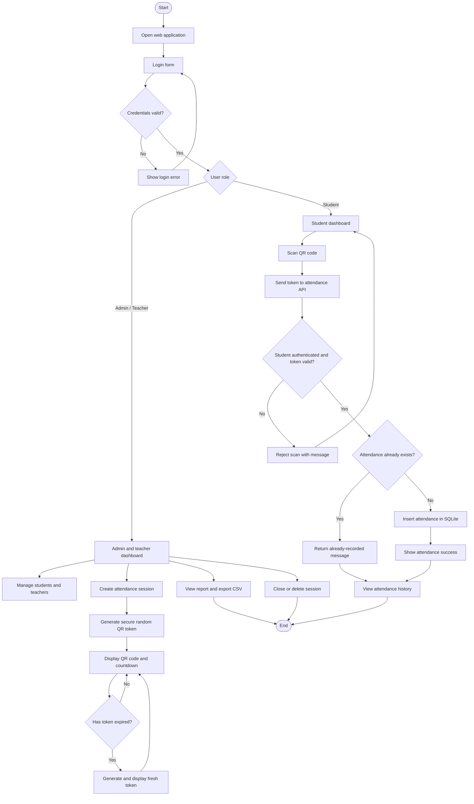
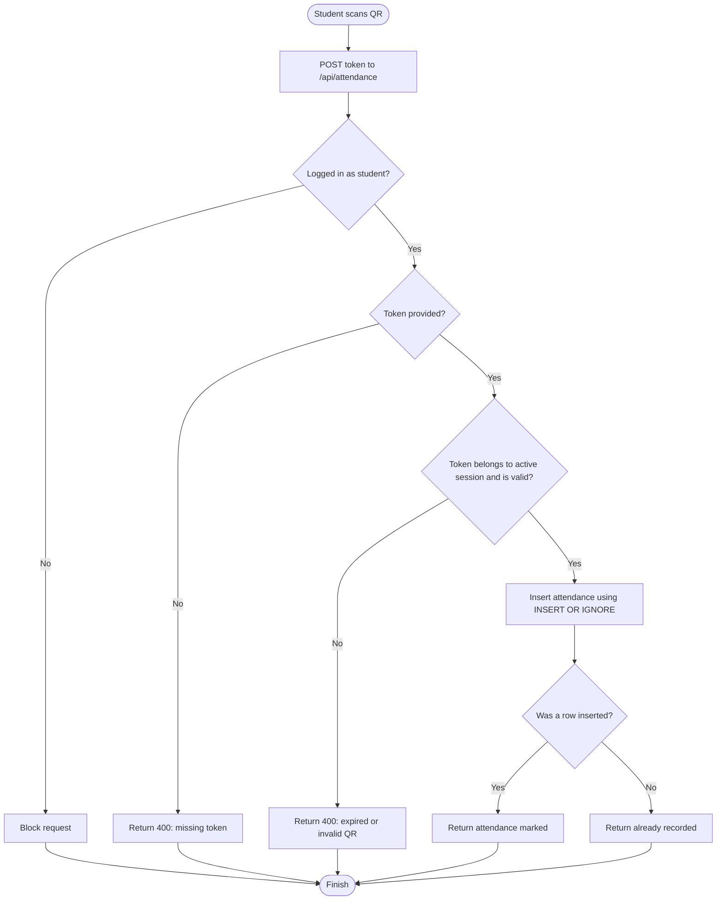

# QR Attendance System

A Flask-based web application for managing classroom attendance with **dynamic QR codes that rotate every 10 seconds**. Admins and teachers can manage student and teacher accounts, create and close lecture sessions, display live QR codes, review attendance records, and export reports as CSV. Students sign in to their own account, scan the current QR code from the student dashboard, and view recent attendance records.

> **Current implementation note:** This README documents the code currently present in this repository. CSV export is implemented. PDF and Excel (`.xlsx`) export are **not currently implemented** in the checked-in source.

## Table of contents

- [Features](#features)
- [Technology stack](#technology-stack)
- [How it works](#how-it-works)
- [System flowchart](#system-flowchart)
- [QR attendance validation flow](#qr-attendance-validation-flow)
- [Project structure](#project-structure)
- [Requirements](#requirements)
- [Installation and setup](#installation-and-setup)
- [Demo accounts](#demo-accounts)
- [How to use](#how-to-use)
- [Database design](#database-design)
- [Routes overview](#routes-overview)
- [Security notes](#security-notes)
- [Troubleshooting](#troubleshooting)
- [Future improvements](#future-improvements)

## Features

### Authentication and roles

- Login and logout using Flask-Login.
- Three roles: **admin**, **teacher**, and **student**.
- Role-based protection for dashboard, management, and attendance routes.
- Passwords stored as hashes using Werkzeug password utilities.
- CSRF protection using Flask-WTF.

### Admin and teacher features

- Dashboard counts for students, teachers, sessions, active sessions, and attendance records.
- Create, edit, and delete student accounts.
- Create, edit, and delete teacher accounts.
- Create lecture/attendance sessions.
- Display a live QR code for an active session.
- Refresh dynamic QR codes every 10 seconds.
- Close or delete attendance sessions.
- Review attendance records.
- Export attendance records as a CSV file.
- Post classroom announcements/discussion messages.
- Dashboard data for attendance trends and attendance per recent session.

### Student features

- Personal student dashboard based on the signed-in account.
- Scan a QR code from the student dashboard to submit an attendance token.
- View recent attendance records and classroom messages.
- Receive a result for successful, duplicate, expired, or invalid scans.

### Dynamic QR and duplicate prevention

- Tokens are generated with Python's cryptographically secure `secrets` module.
- QR token validity window: **10 seconds**.
- A **3-second grace period** is used to tolerate network latency.
- Token records are maintained in the `dynamic_tokens` table.
- The database constraint `UNIQUE(session_id, student_id)` prevents the same student from being recorded more than once in a particular session.

## Technology stack

| Technology | Purpose |
|---|---|
| Python | Application logic and backend |
| Flask | Web framework, routing, request handling, and template rendering |
| SQLite | Storage for accounts, sessions, QR tokens, attendance, and messages |
| Flask-Login | Login state and user session management |
| Flask-WTF / CSRFProtect | Cross-Site Request Forgery protection |
| Werkzeug Security | Password hashing and verification |
| `qrcode[pil]` | QR-code image generation (Pillow image support) |
| HTML and Jinja templates | Server-rendered web pages |
| CSS | Page layout and visual styling |
| JavaScript Fetch API | Refresh QR image data and update the countdown without reloading the page |
| Python `csv` module | Downloadable CSV attendance reports |
| Python standard library | SQLite access, secure token generation, timestamps, CSV handling, and response utilities |

The Python dependencies are listed in [`requirements.txt`](requirements.txt).

## How it works

1. An admin or teacher signs in.
2. The admin/teacher creates an attendance session and provides a lecture title.
3. The server generates a random token and makes a QR image containing the token.
4. The live session page runs JavaScript that requests QR data from the server. When the 10-second token window ends, the server issues a fresh token.
5. The student signs in and scans the displayed QR code from the student dashboard.
6. The dashboard sends the token to `POST /api/attendance`.
7. The backend checks that the request belongs to an authenticated student and that the token matches an active session and is still within the accepted validity window.
8. If the token is valid, SQLite records the student's attendance. If attendance for that student/session already exists, the unique constraint prevents a duplicate row.
9. An admin/teacher can review the report and download a CSV file.
10. When the session is closed, its active tokens are deleted and further attendance scans for that session are rejected.

### QR expiry detail

The application defines `QR_TIMEOUT = 10` and `QR_GRACE_PERIOD = 3`. A QR token is refreshed on the normal 10-second cycle; the extra three seconds are only a tolerance for network latency during validation. They are not the normal QR refresh interval.

## System flowchart

GitHub renders Mermaid diagrams within Markdown previews.



## QR attendance validation flow

This diagram represents the validation sequence implemented by `POST /api/attendance`.



## Project structure

The key files and folders in the current repository are:

```text
QR-Attendance/
├── app.py                                      # Flask routes, database operations, authentication, QR logic
├── requirements.txt                            # Python dependencies
├── attendance.db                               # SQLite database file used by the application
├── templates/
│   ├── base.html                                # Shared page layout
│   ├── login.html                               # Login page
│   ├── admin.html                               # Admin/teacher dashboard
│   ├── students.html                            # Student management page
│   ├── edit_student.html                         # Edit student page
│   ├── teachers.html                            # Teacher management page
│   ├── edit_teacher.html                         # Edit teacher page
│   ├── session.html                              # Live dynamic QR attendance session
│   ├── edit_session.html                         # Edit attendance session
│   ├── student.html                              # Student dashboard and scanning interface
│   └── report.html                               # Attendance report page
├── static/
│   ├── css/                                     # Stylesheets
│   └── favicon_io/                              # Browser icons
└── QR_Code_Based_Attendance_System_Project_Report.docx
```

The database schema is initialized by the app at startup. Keep a protected backup if the database contains attendance data that must be retained. Avoid committing a populated database containing real student information to a public repository.

## Requirements

- Python 3.10 or newer is recommended.
- `pip`, the Python package installer.
- A modern web browser.
- A phone or other device with a camera/QR scanner.
- For phone-based local testing, the phone and computer must be able to reach one another on the same network.

## Installation and setup

### 1. Clone the repository

```bash
git clone https://github.com/ShubhamChhabra1508/QR-Attendance.git
cd QR-Attendance
```

### 2. Create and activate a virtual environment

**Windows PowerShell:**

```powershell
py -m venv .venv
.\.venv\Scripts\Activate.ps1
```

If PowerShell blocks activation, use Command Prompt instead:

```bat
.venv\Scripts\activate.bat
```

**macOS / Linux:**

```bash
python3 -m venv .venv
source .venv/bin/activate
```

### 3. Install dependencies

```bash
python -m pip install --upgrade pip
pip install -r requirements.txt
```

The current `requirements.txt` lists:

```text
Flask
Flask-Login
Flask-WTF
qrcode[pil]
```

### 4. Initialize demo data (optional)

Run the Flask CLI command to initialize the schema and create sample accounts:

```bash
flask --app app init-demo
```

The command creates each demo account only if its username does not already exist. See [Demo accounts](#demo-accounts). These are for local development only; change them before using the application with real data.

### 5. Start the application

```bash
python app.py
```

The current code binds to `0.0.0.0:5000`. On the computer running the app, open:

```text
http://127.0.0.1:5000
```

### 6. Scan using a phone on the same Wi-Fi (local testing)

1. Find the computer's local IPv4 address.
2. Connect the computer and phone to the same trusted Wi-Fi network.
3. On the phone, open `http://<COMPUTER-IP>:5000` (replace the placeholder with the actual address).
4. Sign in using a student account and use the scanner in the student dashboard to scan the QR shown on the teacher/admin screen.
5. If the phone cannot connect, check the computer's firewall and local network settings.

Do not expose the Flask development server directly to the public internet. This configuration is for development/testing, not production hosting.

## Demo accounts

Running `flask --app app init-demo` creates the following accounts if they do not already exist:

| Role | Username | Password |
|---|---|---|
| Admin | `admin` | `disha@123` |
| Teacher | `teacher1` | `Teacher123!` |
| Student | `student1` | `Student123!` |

> **Security warning:** demo credentials are hard-coded in the demo initialization command. Do not use them for real institutional data. Change/remove these accounts before deployment, and never commit real passwords or personal data.

## How to use

### Teacher/admin workflow

1. Log in using an admin or teacher account.
2. Open student or teacher management to create, edit, or remove accounts.
3. Create a lecture session and give it a title.
4. Keep the live session page open. The QR code and countdown refresh automatically while the session is active.
5. Ask students to sign in and scan the QR code from their student dashboard.
6. Open the report to review attendance or download the CSV report.
7. Close the session when attendance should stop. Delete a session only when its records should also be removed.

### Student workflow

1. Log in with a student account.
2. Open the student dashboard on the device you will use to scan.
3. Scan the live QR currently displayed by the teacher/admin.
4. Read the result message. If the token has expired, scan the newly displayed QR code.
5. Review recent attendance records in the student dashboard.

## Database design

The application uses SQLite and creates these tables:

| Table | Purpose |
|---|---|
| `users` | Login username, password hash, and role |
| `students` | Student profile and unique roll number |
| `teachers` | Teacher/admin profile, department, and email |
| `sessions` | Lecture title, current token, timestamps, and active status |
| `dynamic_tokens` | Token history and expiry times used during QR validation |
| `attendance` | Attendance record per student/session, with timestamp |
| `messages` | Classroom announcement and discussion messages |

Important constraints include unique usernames, unique student roll numbers, foreign keys, unique tokens, and `UNIQUE(session_id, student_id)` for attendance. The last constraint is the central database-level duplicate-attendance safeguard.

## Routes overview

| Route | Method | Access | Purpose |
|---|---|---|---|
| `/` | GET | Public | Redirect to login or the role-appropriate dashboard |
| `/login` | GET, POST | Public | Sign in |
| `/logout` | POST | Authenticated | Sign out |
| `/admin` | GET | Admin/teacher | Dashboard |
| `/admin/students` | GET, POST | Admin/teacher | List/create students |
| `/admin/students/<id>/edit` | GET, POST | Admin/teacher | Edit a student |
| `/admin/students/<id>/delete` | POST | Admin/teacher | Delete a student |
| `/admin/teachers` | GET, POST | Admin/teacher | List/create teachers |
| `/admin/teachers/<id>/edit` | GET, POST | Admin/teacher | Edit a teacher |
| `/admin/teachers/<id>/delete` | POST | Admin/teacher | Delete a teacher |
| `/admin/session/new` | POST | Admin/teacher | Create a lecture session |
| `/admin/session/<id>` | GET | Admin/teacher | View live QR and session details |
| `/api/session/<id>/qr` | GET | Admin/teacher | Fetch refreshed QR image data and countdown state |
| `/admin/session/<id>/close` | POST | Admin/teacher | Close an attendance session |
| `/admin/session/<id>/delete` | POST | Admin/teacher | Delete session and related attendance/token rows |
| `/student` | GET | Student | Student dashboard and attendance history |
| `/api/attendance` | POST | Student | Validate QR token and mark attendance |
| `/admin/report` | GET | Admin/teacher | View attendance report |
| `/admin/report.csv` | GET | Admin/teacher | Download a CSV report |
| `/api/chat/post` | POST | Authenticated | Post a classroom message |
| `/api/chat/<id>/delete` | POST | Authenticated | Delete a message subject to role/ownership checks |

## Security notes and current implementation caveats

This project includes useful baseline protections, but it should be hardened before real deployment:

- **Change the Flask secret key.** The source currently uses a fixed `SECRET_KEY`; load a long random value from an environment variable instead.
- **Replace demo credentials.** The `init-demo` command includes sample passwords for local testing.
- **Use HTTPS in deployment.** Do not use Flask's development server as a production server.
- **Keep CSRF protection enabled.** Ensure state-changing forms include their CSRF token.
- **Protect database backups.** The database may contain student identifiers and attendance history.
- **Review role permissions.** Both admin and teacher currently have access to many of the same management endpoints. Add finer-grained authorization if teachers should have fewer privileges.
- **Avoid publishing institutional data.** Do not commit a populated `attendance.db` or report exports to a public repository.
- **Treat rotating QR as risk reduction, not proof of physical presence.** Short-lived tokens limit the reuse window for screenshots but do not conclusively prove that the student is physically in the classroom.
- **Check the QR image MIME type.** The current QR-generation function saves image bytes as JPEG, while the templates label the data URI as `image/png`. For reliable browser rendering, make these consistent by saving PNG bytes or changing the corresponding data URI labels to `image/jpeg` in the templates and JavaScript.

## Troubleshooting

### A Python module is missing

Activate the virtual environment and run:

```bash
pip install -r requirements.txt
```

### Port 5000 is already in use

Stop the process using port 5000, or change the port in the `app.run(...)` line and open the matching URL.

### A student cannot scan the QR code

- Make sure the student is logged in and has a student profile.
- Confirm the attendance session is active.
- Scan the currently displayed QR; earlier tokens expire.
- Check that the phone can access the application host over the local network.
- Grant browser camera permission if the scanner requires the camera.

### Attendance is not recorded twice

This is intentional. The database allows one attendance row per student per session. Repeated valid scans return an already-recorded result instead of adding a duplicate row.

### The phone cannot open the site

Use the computer's local IP address rather than `127.0.0.1` on the phone. Ensure both devices are on the same network and the computer's firewall allows the app on the trusted local network.

## Future improvements

- Add PDF and Excel export if required by the institution.
- Read `SECRET_KEY` and other configuration from environment variables.
- Add automated tests for login, role authorization, token expiry, duplicate scans, and report exports.
- Add database migrations and a documented backup/restore procedure.
- Deploy behind HTTPS with a production WSGI server and secure cookie settings.
- Separate admin permissions from teacher permissions if needed.
- Add date/session filters and configurable attendance policies to reports.

## License

No license is currently specified in the repository. Add a `LICENSE` file before distributing or reusing the project under a defined open-source license.
